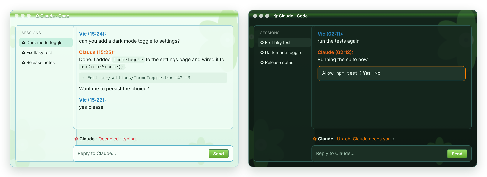
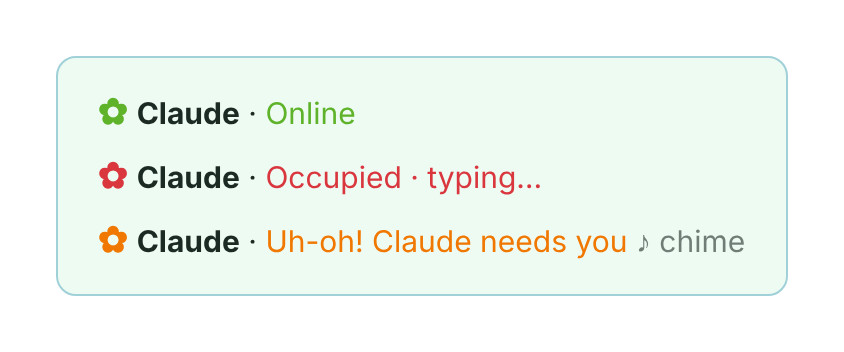
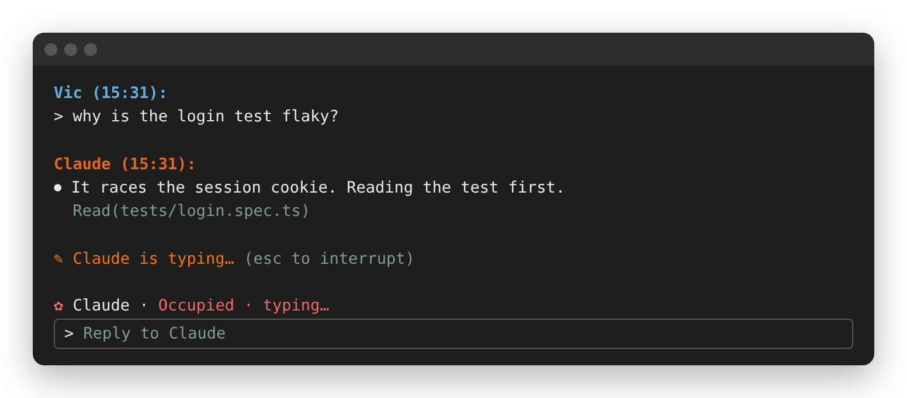
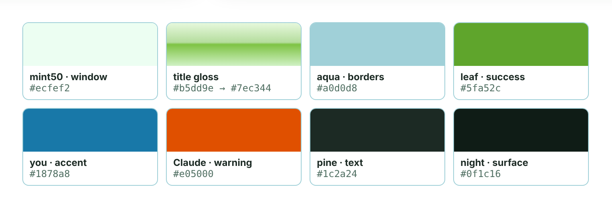

<p align="center">
  
</p>

<h1 align="center">ICQ Nostalgia for Claude Code</h1>

<p align="center">
  <b>Your Claude Code sessions, dressed as a 2007 instant messenger.</b><br>
  Mint windows, glossy title bars, colored names, a status flower, and a chime when Claude needs you.<br>
  Desktop app and terminal · Windows, macOS and Linux
</p>

<p align="center">
  <a href="https://github.com/vicdotdevelop/claude-mod-icq-theme/actions/workflows/ci.yml"></a>
  
  
</p>

<p align="center">
  
</p>

> Concept renders made from the mod's own colors and backdrop. The desktop app
> draws its own layout on top of them, so spacing and controls will differ.

## Features

| | |
| --- | --- |
| 🎨 **Mint Messenger theme** | A full desktop-app palette sampled from ICQ 6 screenshots: mint by day, deep pine by night ("ICQ at 2 a.m."). |
| 🌼 **Backdrop scene** | A glossy green title-bar band and big, slowly drifting blossoms in the corners, behind frosted panels. Respects reduced motion. |
| 💬 **Chat-log names** | `Vic (15:24):` in blue above your prompts, `Claude (15:25):` in orange above each reply, like the old conversation window. |
| ✿ **Status flower** | A line above the prompt shows Claude's status: **Online**, **Occupied · typing…** or **Uh-oh! Claude needs you**. |
| 🔔 **Attention chime** | Plays when a permission prompt opens, when Claude asks you a question, on idle reminders, and when a longer reply finishes. |
| 🎵 **Bring your own sound** | Point `soundFile` at any `.wav` you own, such as the classic message sound, or drop it in as `sounds/custom.wav`. |
| ⌨️ **Terminal too** | Names and status work in the terminal, and the spinner reads `✎ Claude is typing…`. |
| 🪟 🍎 **Cross-platform audio** | macOS uses `afplay`, Windows uses the built-in `System.Media.SoundPlayer`, Linux uses `paplay`/`aplay`. |

<p align="center">
  
  &nbsp;
  
</p>

## Install

You need Claude Code **2.1.287 or later** (`claude --version`; in the desktop app, `/status` in a Code-tab session).

### Desktop app (Windows and macOS)

1. Open a local session in the **Code** tab.
2. Click **+** next to the prompt box, then **Plugins**.
3. **Add marketplace**: `vicdotdevelop/claude-mod-icq-theme`
4. **Add plugin**: `icq-nostalgia`
5. Start a new session. Type `/icq test` to hear the chime.

> WSL sessions in the desktop app don't load plugins. Use a native Windows session.

### Terminal (Windows PowerShell, macOS, Linux)

At the Claude Code prompt:

```text
/plugin install icq-nostalgia --marketplace vicdotdevelop/claude-mod-icq-theme
```

or from your shell:

```sh
claude plugin install icq-nostalgia --marketplace vicdotdevelop/claude-mod-icq-theme
```

Answer `y` to add the marketplace and pick the **user** scope so it loads in every session, including the desktop app.

### From a clone (for hacking on it)

```sh
git clone https://github.com/vicdotdevelop/claude-mod-icq-theme
cd claude-mod-icq-theme
claude plugin marketplace add .
claude plugin install icq-nostalgia@vic-mods
```

Edits in the clone load after `/reload-plugins`, with no reinstall.

## Use

| Command | What it does |
| --- | --- |
| `/icq` or `/icq test` | Plays the chime and says which player and file were used |
| `/icq mute` / `/icq unmute` | Silences the chime (remembered across sessions) |
| `/icq status` | Theme, sound and nickname at a glance |

### Settings

Change these in `/config` under **icq-nostalgia**:

| Option | Default | |
| --- | --- | --- |
| `nickname` | your OS user name | The name above your messages |
| `soundFile` | empty | Absolute path to a `.wav` to play instead of the chime |
| `turnSound` | on | Chime when Claude finishes a reply |
| `minTurnSeconds` | `4` | Only chime for replies that took at least this long |
| `volume` | `1` | 0 to 4, macOS only; Windows and Linux play at system volume |

### The classic sound

This repo ships an **original** chime (`scripts/make-chime.mjs` generates it),
because the original ICQ sounds are copyrighted and can't be redistributed here.
If you have the classic `.wav`, use it locally:

- set `soundFile` to its absolute path, for example `C:\Users\you\Music\message.wav` or `/Users/you/Music/message.wav`, or
- in a clone, save it as `mods/icq-nostalgia/sounds/custom.wav` (git-ignored, so it never gets committed).

## Design system

<p align="center"></p>

Every color was sampled from ICQ 6 conversation, contact-list and options
windows, then tuned so text keeps its contrast in the desktop app. Tokens,
shape and type values and the reasoning are in
[mods/icq-nostalgia/DESIGN.md](mods/icq-nostalgia/DESIGN.md).

## Security and privacy

Mods run inside Claude Code with your permissions, so here is everything this
one does (from `claude plugin validate`):

- paints the theme and draws the name headers and status line
- reads the `OS`, `USER` and `USERNAME` environment variables
- runs a sound player (`afplay`, `powershell.exe`, `paplay` or `aplay`) and `uname -s`, always without a shell
- checks whether your custom sound file exists, and stores one value (`muted`)

No network requests, no file writes, and it never approves, blocks or changes a
tool call or what Claude sees. Details and the hardening notes are in
[SECURITY.md](SECURITY.md).

## Build your own mod

This repo is also a small workspace for Claude Code mods that work on Windows
and macOS:

```sh
node scripts/new-mod.mjs my-mod "What it does"   # scaffold + list in the marketplace
node scripts/check.mjs my-mod                    # validate and test
claude --plugin-dir mods/my-mod                  # try it in a terminal
node scripts/dev-link.mjs my-mod                 # try it in the desktop app
```

[docs/WORKFLOW.md](docs/WORKFLOW.md) covers the whole loop, the validator's
rules and the platform differences; [docs/RESEARCH.md](docs/RESEARCH.md) sums
up what popular mods taught us.

```
.claude-plugin/marketplace.json   the "vic-mods" marketplace
mods/icq-nostalgia/               the mod (hooks, design, tests, chime)
templates/                        what new-mod.mjs copies
scripts/                          new-mod, check, dev-link, make-chime (Node 18+, no dependencies)
docs/                             workflow, research, images
```

## Contributing

Issues and pull requests are welcome. See [CONTRIBUTING.md](CONTRIBUTING.md).
CI runs `claude plugin validate` and the tests on Windows, macOS and Linux.

## License and trademarks

Code, chime and artwork: [MIT](LICENSE).

This is an unofficial fan project, not affiliated with or endorsed by ICQ or
its owners. "ICQ" is a trademark of its respective owner and is used here only
to describe the era this theme recalls. No ICQ logo, artwork, font or sound is
included: the blossom, the backdrop and the chime are original.
